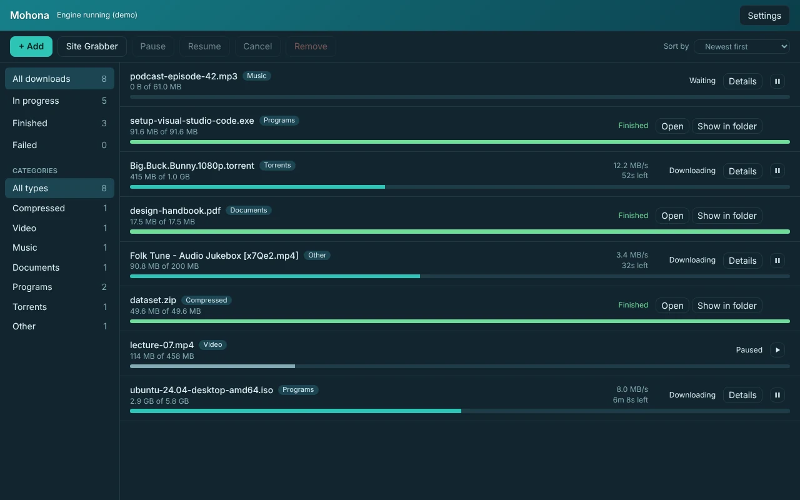
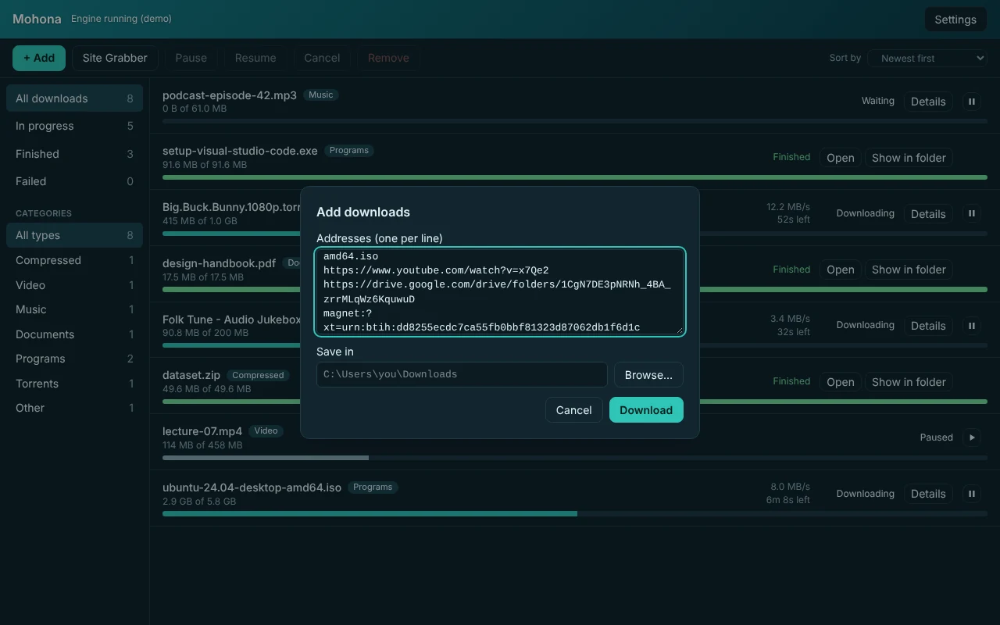
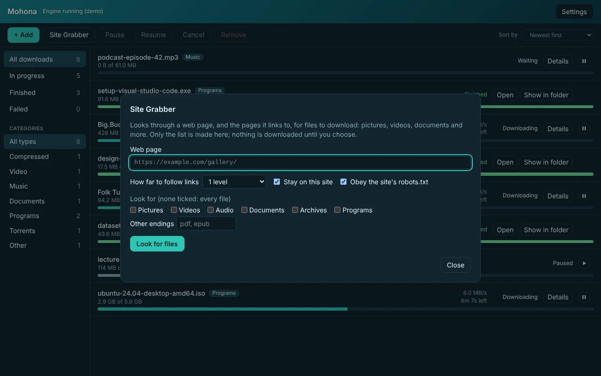
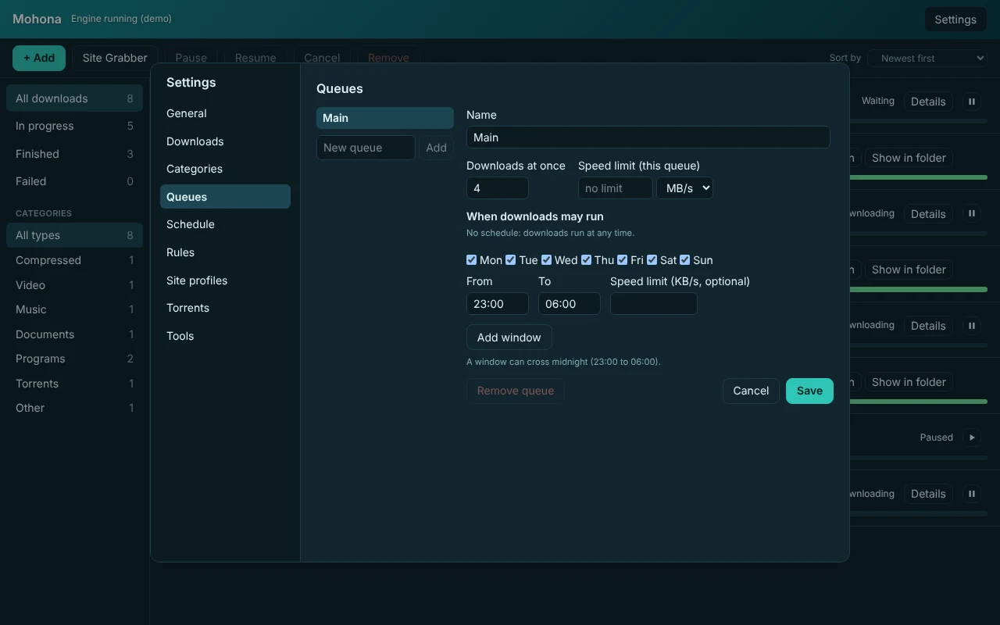
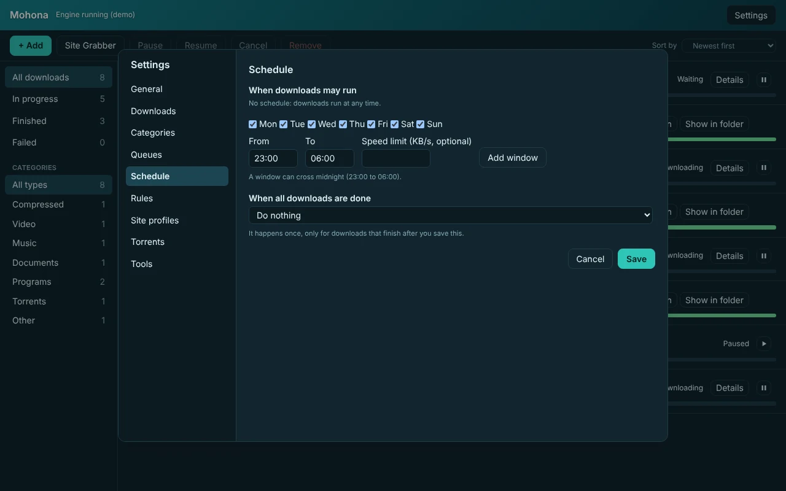
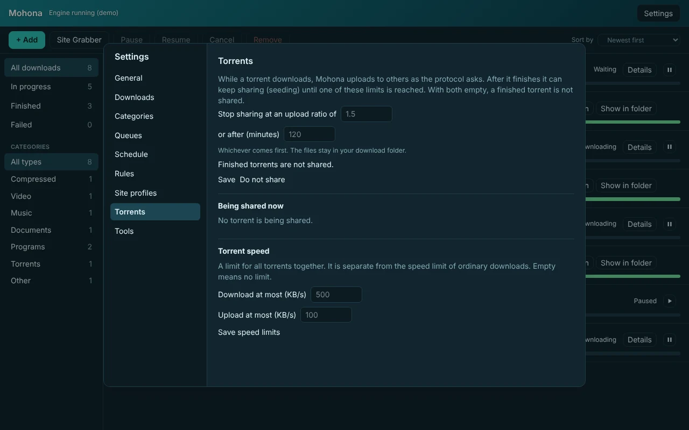
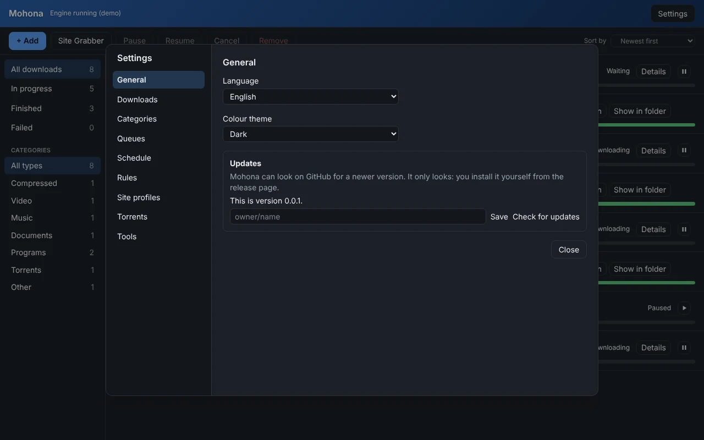
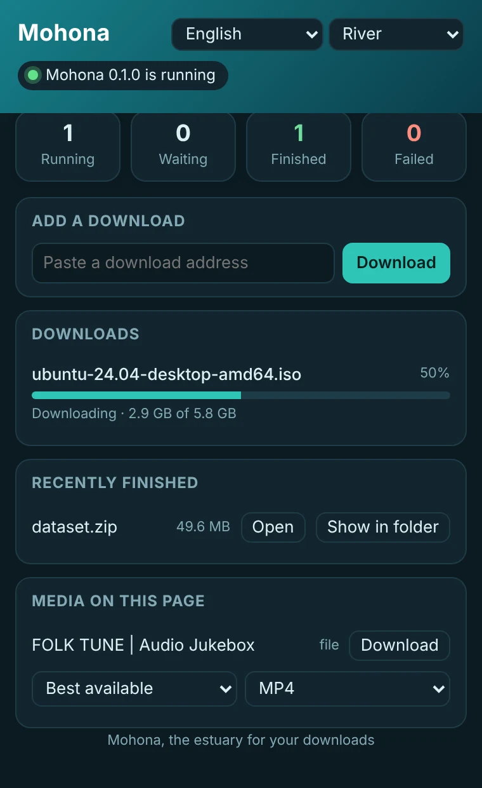
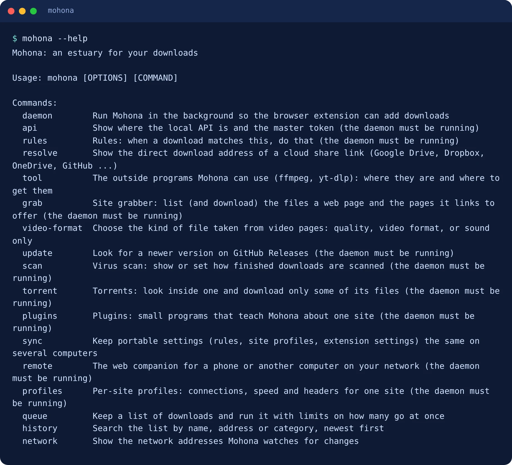
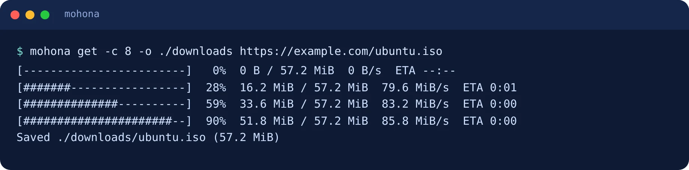

# The Mohona guide

How to install Mohona, use it from the window, from the command line, and from your browser. Every picture here is the real program.

- [1. Install](#1-install)
- [2. The window](#2-the-window)
- [3. The browser extension](#3-the-browser-extension)
- [4. The command line](#4-the-command-line)
- [5. Video and sound](#5-video-and-sound)
- [6. Updates](#6-updates)
- [7. When something goes wrong](#7-when-something-goes-wrong)

## 1. Install

Get the file for your system from the [Releases page](https://github.com/arifulalam/mohona/releases/latest). Each file has a `.sha256` file beside it with its checksum.

| System | File | How |
| --- | --- | --- |
| Windows 10/11 | `Mohona_<version>_x64-setup.exe` | Run it. It installs for your user (no administrator rights), adds the tray icon, and connects Chrome, Edge and Firefox. |
| macOS (Apple silicon) | `Mohona_<version>_aarch64.dmg` | Open it, drag Mohona to Applications. The first start: right-click → Open (the app is not yet signed by Apple). |
| macOS (Intel) | `Mohona_<version>_x64.dmg` | The same. |
| Debian, Ubuntu | `Mohona_<version>_amd64.deb` | `sudo apt install ./Mohona_<version>_amd64.deb` |
| Any Linux | `Mohona_<version>_amd64.AppImage` | `chmod +x` it and run it. |

Then connect your browsers once (the Windows installer does this itself):

```
mohona-host install --browser all
```

Only the command-line program, from source: `cargo install --git https://github.com/arifulalam/mohona mohona` (needs [Rust](https://rustup.rs)).

## 2. The window



The list shows each download with its progress, speed and time left. The left side holds the categories (Video, Music, Documents, Programs, Compressed, and your own), the queues and the torrents. Click a finished download for **Open** and **Show in folder**; a download that is gone from its folder says so and offers **Download again**.

**Add downloads.** Press **+ Add** and paste web addresses (one per line), magnet links, video-page addresses or a Google Drive *folder* link. Mohona also offers to download a link when you copy one (Settings), and a small **drop target** on the screen takes links you drag onto it.



**Site Grabber.** Give it a page; it lists every file the page offers, and you pick what to download.



**Queues and the schedule.** A queue runs its downloads a few at a time, with its own speed limit. The schedule lets downloads run only at night, or on weekdays, and can shut the computer down when everything is done.




**Torrents.** Magnet links and `.torrent` files work like any download. A finished torrent is shared until you stop it, and torrents have their own speed limits.



**Themes and languages.** Eleven themes (Light, Dark, Desert, Forest, Leaf, Orange, River, Earth, Sky, Sunny, Water) and 13 languages, including right-to-left ones: Settings. The browser extension and this website use the same themes.



**Other things in Settings.** Start with Windows (in the tray), the tray icon, notifications with *Open* and *Show in folder* buttons, a virus scan after each download (Windows Defender, or your own program), sorting finished files into folders by type, and categories.

## 3. The browser extension

The extension sends the browser's downloads to Mohona, adds *Download with Mohona* to the right-click menu, finds videos and files on a page, and puts a small **Mohona** button on video players.



**Install it.**

1. *From the store* (when the listing is live): search for "Mohona" in the Chrome Web Store, Edge Add-ons or Firefox Add-ons and press Add. The listing steps are in [store.md](store.md).
2. *From the installer* (works today): open Mohona → Settings → Browsers → **Folder for Chrome, Edge, Brave** (or **Folder for Firefox**). Then in the browser open `chrome://extensions` (Edge: `edge://extensions`), turn on **Developer mode**, press **Load unpacked** and choose that folder. In Firefox open `about:debugging` → *This Firefox* → **Load Temporary Add-on** and choose `manifest.json` in the Firefox folder (Firefox forgets temporary add-ons when it closes; the store version stays).
3. Make sure the browser is connected: `mohona-host status`. If it says *not registered*, run `mohona-host install --browser all`.

**Use it.**

- Click any download link: Mohona takes it over. When Mohona is not running, the browser downloads it as usual.
- On a video page (YouTube and others) press the **Mohona** button on the player or the extension icon. Under "Video on this page" pick the **quality** (best, 2160p … 360p, or *Sound only*) and the **format** (MP4, MKV, WebM, MOV, AVI; or MP3, M4A, OPUS, OGG, FLAC, WAV, AAC), then **Download**. Your last choice is remembered.
- Press **Download** on something you already have: you get **Open** and **Show in folder**, or, if the file was deleted, **Download again**.
- Settings → Browsers (in the app) holds the switches: take over downloads, show the button on videos, renew expired links, smallest file size to take over, sites to leave alone.

## 4. The command line

The `mohona` program does everything the window does, and works over SSH or on a server. The full list with examples is [commands.md](commands.md); the main ones:



```
mohona get "https://example.com/big.iso" --output downloads     # one file, several connections, resumes if you run it again
mohona get "https://example.com/big.iso" -c 16 -l 2M            # up to 16 connections, 2 MB/s
mohona queue add "https://example.com/a.zip" "https://example.com/b.zip"
mohona queue list
mohona queue run --then shutdown --countdown 60                 # download everything, then shut down
mohona queue schedule --days mon-fri --from 01:00 --to 07:00 --speed 2M
mohona grab "https://example.com/files/"                         # list the files a page offers
mohona video-format --quality 720 --format mkv                # the default for video pages
mohona stream "https://example.com/live/index.m3u8"             # HLS and DASH
mohona scan --help                                               # virus scan after downloads
mohona update                                                    # is there a newer version?
```



**Run it in the background** so the extension and other programs can use the same engine: `mohona daemon`. The window starts one for itself; run the daemon yourself only on a server. A local web API (`127.0.0.1:6791`, with an OpenAPI description) lets your own scripts add and list downloads: `mohona api`.

## 5. Video and sound

Video pages need two free programs next to Mohona: **yt-dlp** (finds the video) and **ffmpeg** (joins and converts). Mohona looks for them in its settings, then in `PATH`, then in the usual places. Settings → Tools shows what it found, and the same page holds the default quality and format. Without ffmpeg only ready-made single files work, and Mohona says so.

If a video fails, the download's log shows yt-dlp's own words and a hint. `[Errno 22] Invalid argument` on Windows means the file name or folder was refused: use a short, plain download folder such as `C:\Downloads`.

## 6. Updates

*Check for updates* in the app's Settings asks GitHub for the newest release. On Windows, **Install now** downloads the installer, checks it against the checksum published with it, closes Mohona and runs it. If a release has no checksum, nothing is run. On macOS and Linux the button opens the release page.

## 7. When something goes wrong

- **A download shows "Failed"**: run `mohona log <number>` (the number is in the list). It says what the server answered.
- **The extension does nothing**: `mohona-host status`; then reload the extension and the page.
- **The installer says a file is in use**: close Mohona and the browser, run it again.
- **A video will not download**: see section 5.
- Anything else: [open an issue](https://github.com/arifulalam/mohona/issues) with the log line.
