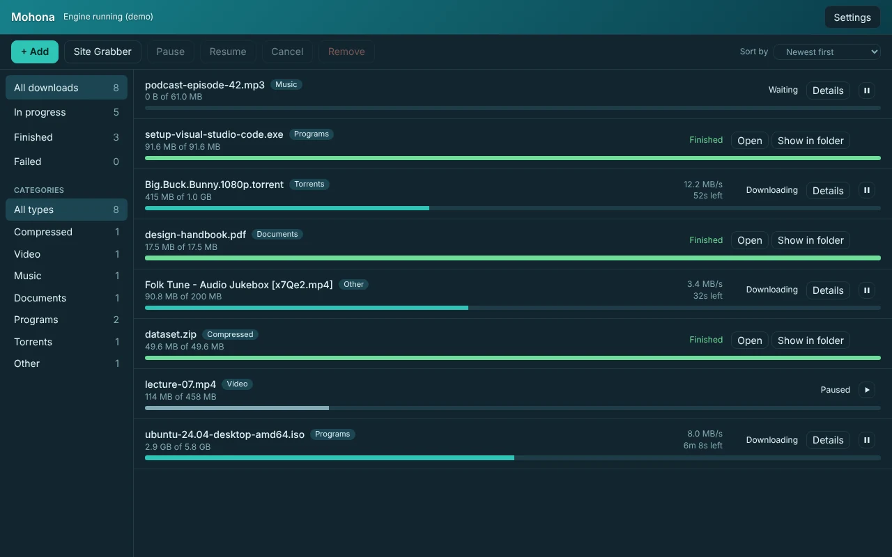
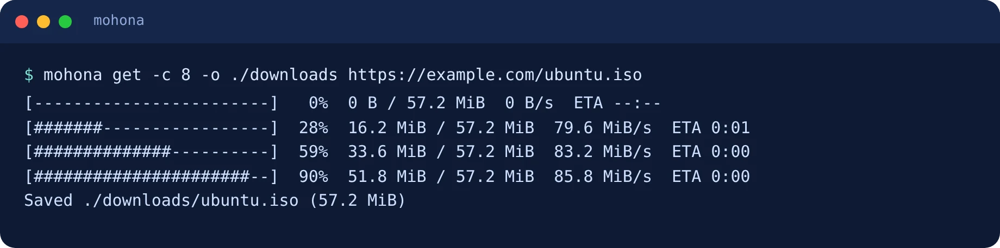
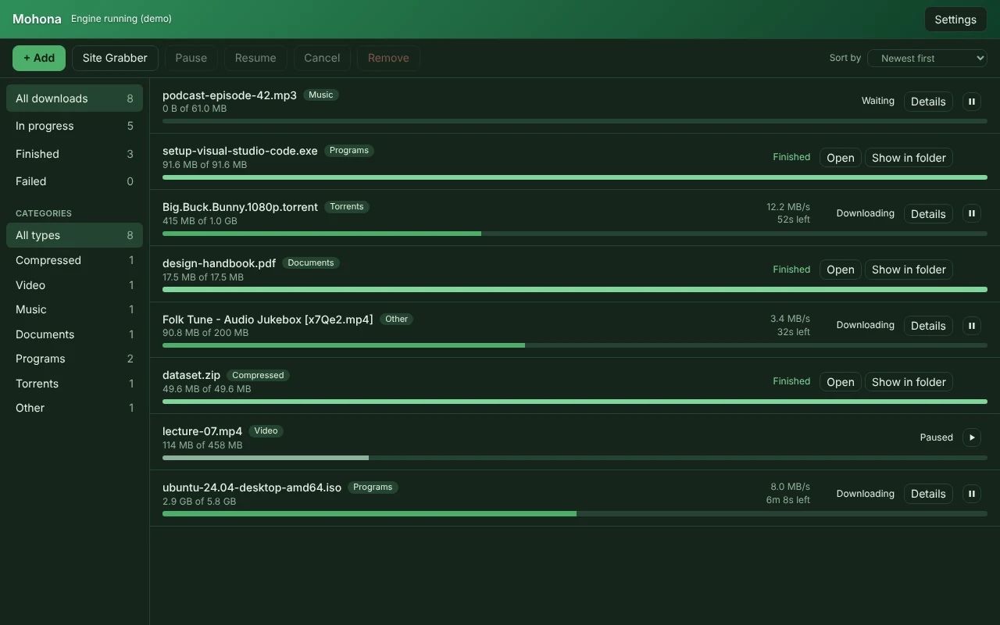
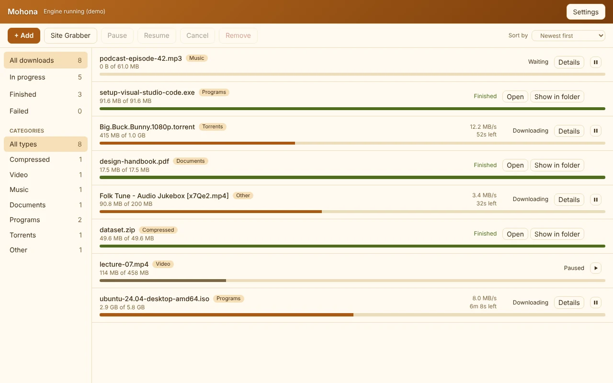
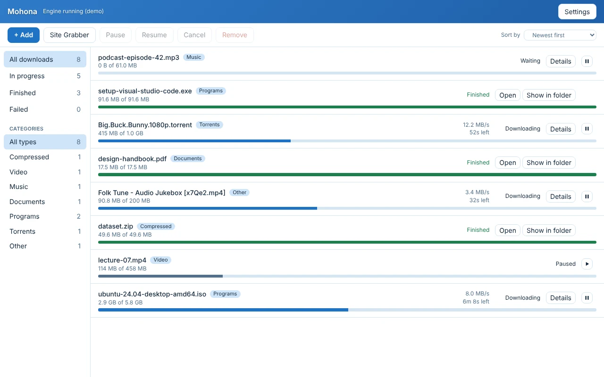

<p align="center">
  
</p>

<h1 align="center">Mohona (মোহনা)</h1>
<p align="center"><b>An estuary for your downloads.</b><br>A free, open-source download manager for Windows, macOS and Linux.</p>

<p align="center">
  <a href="https://github.com/arifulalam/mohona/releases/latest">Download</a> ·
  <a href="https://arifulalam.github.io/mohona/">Website</a> ·
  <a href="docs/GUIDE.md">Guide</a> ·
  <a href="docs/commands.md">Command line</a> ·
  <a href="docs/BUILDING.md">Build it</a>
</p>

<p align="center"></p>

## Why the name

*Mohona* (মোহনা) is Bengali for the **mouth of a river**: the place where many streams meet and flow into the sea. That is the job of a download manager: files, video sites, torrents and browser downloads arrive from everywhere, and Mohona brings them into one place. The icon shows it: an arrow dropping into the water.

## What it does

- **Fast, resumable downloads.** Splits each file over up to 32 connections, measures the server and keeps only the connections that help, retries, and continues after a crash, a power cut or a network change. A finished file is never corrupted or overwritten.
- **Your browser, taken over.** A browser extension (Chrome, Edge, Brave, Firefox) sends downloads to Mohona, adds a *Download with Mohona* menu, and puts a button on video players.
- **Video and sound.** YouTube and many other sites, through yt-dlp and ffmpeg: choose the quality (up to 2160p) and the format (MP4, MKV, WebM, MOV, AVI) or take only the sound (MP3, M4A, OPUS, OGG, FLAC, WAV, AAC).
- **More than HTTP.** FTP, FTPS, SFTP, WebDAV, HLS and DASH streams, BitTorrent and magnet links, share links of Google Drive (files and folders), Dropbox and OneDrive, and a Site Grabber that lists every file a page offers.
- **Organised.** Queues with their own limits, a scheduler (nights, weekdays, shut down when done), categories and rules that send files to the right folder, speed limits at three levels, checksum verification and a virus scan after each download.
- **Comfortable.** Tray icon, notifications with *Open* and *Show in folder*, a drop target for links, start with Windows, 11 colour themes, 13 languages (including right-to-left), and updates from GitHub with a checked installer.
- **Scriptable.** A real command line (`mohona get`, `queue`, `grab`, `stream` …), a local web API with an OpenAPI description, plugins and a web companion for your phone's browser.
- **Private.** No account, no ads, no telemetry. Nothing leaves your computer except the downloads you ask for. See [docs/privacy.md](docs/privacy.md).

## Install

Get the file for your system from the [latest release](https://github.com/arifulalam/mohona/releases/latest):

| System | File |
| --- | --- |
| Windows 10/11 | `Mohona_<version>_x64-setup.exe` (also sets up the browser connection and carries the extension) |
| macOS | `Mohona_<version>_aarch64.dmg` (Apple silicon), `Mohona_<version>_x64.dmg` (Intel) |
| Linux | `Mohona_<version>_amd64.deb` or `.AppImage` |

Only the command-line program: `cargo install --git https://github.com/arifulalam/mohona mohona`.

Then add the extension: Settings → Browsers → open the extension folder, and load it in your browser (or install it from the browser's store when listed). The [guide](docs/GUIDE.md) walks through it with pictures.

> **Status.** Windows is the hand-tested platform. The Linux and macOS packages are built for every release but have had less testing: please report problems. iOS and Android are not planned for the desktop app; see [docs/BUILDING.md](docs/BUILDING.md#ios-and-android).

## Use it

```
mohona get "https://example.com/big.iso" --output downloads      # one file, many connections, resumes
mohona queue add "https://example.com/a.zip" "https://example.com/b.zip"
mohona queue run --then shutdown --countdown 60                  # run the list, then shut down
mohona video-format --quality 720 --format mkv                   # default for video pages
mohona grab "https://example.com/files/"                          # every file a page offers
```



Everything is explained in the [guide](docs/GUIDE.md) and the [command reference](docs/commands.md).

## Themes

Light, Dark, Desert, Forest, Leaf, Orange, River, Earth, Sky, Sunny and Water: the app, the extension and the [website](https://arifulalam.github.io/mohona/) share them.

| | | |
| --- | --- | --- |
|  |  |  |

## Build it

You need [Rust](https://rustup.rs) and Node.js 22. `cargo test --workspace` tests the engine; `.\scripts\build-windows.ps1` or `./scripts/build-unix.sh` builds the app and its installer. All platforms are built from GitHub by pushing a tag, see [docs/BUILDING.md](docs/BUILDING.md).

## Repository layout

| Path | What it is |
| --- | --- |
| `crates/core` | The download engine (segments, workers, retries) |
| `crates/net` | Transports: HTTP, FTP, SFTP, WebDAV, proxies, authentication |
| `crates/media`, `crates/torrent`, `crates/grabber` | Video and streams, BitTorrent, the site grabber |
| `crates/store`, `crates/manager`, `crates/daemon` | The database, the download manager and the background engine with its API |
| `crates/host`, `extension/` | The browser connector and the browser extension (TypeScript) |
| `crates/appcore`, `app/` | The desktop app's engine link and its Tauri + React interface |
| `crates/cli` | The `mohona` command-line program |
| `site/` | The website (GitHub Pages) |
| `docs/` | The [guide](docs/GUIDE.md), [commands](docs/commands.md), [decisions](docs/decisions.md), [store listing](docs/store.md), [publishing](docs/publishing.md), [tests](docs/windows-testing.md) |

## Contributing

Issues and pull requests are welcome. Before a pull request: `cargo fmt --all`, `cargo clippy --workspace --all-targets -- -D warnings`, `cargo test --workspace`, and in `app/` and `extension/` `npm test`. Translations: [docs/translating.md](docs/translating.md).

## Credits

Prompted and planned by [Ariful Alam](https://syncmachine.com), crafted with [Claude](https://claude.ai) (Anthropic). Commits made with Claude carry a `Co-authored-by: Claude <noreply@anthropic.com>` trailer.

## Licence

MIT or Apache-2.0, at your option.
